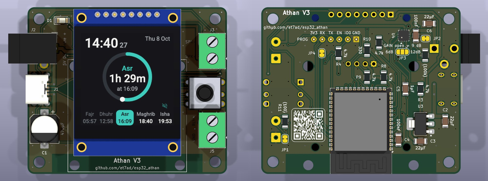
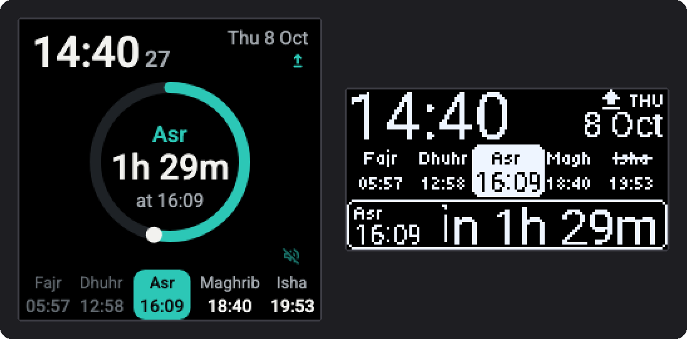

# Athan clock

A small Wi-Fi clock that calls the athan at your mosque's prayer times. It shows the time and the next prayer,
plays Quran radio, and can switch a relay before Fajr (one controlling a room light, for example). It runs on an
ESP32-S3 with a small amplifier, and keeps its sounds and a whole year of prayer times in its own memory, so the
athan keeps playing without internet.



> **Have an older clock (ESP8266 with a DFPlayer, "version 2")?** Its firmware and prayer times are in
> [et7ad/esp_athan](https://github.com/et7ad/esp_athan), which supports the clocks already in use. New clocks use
> this repository.

## Why the prayer times come from this repository

Every mosque publishes its prayer times its own way: a PDF, a web page, a spreadsheet, an app. Rather than teach
the clock all of them, this project splits the job of keeping a clock in step with its mosque into two parts.

The clock's part is small, and the same for every mosque. It downloads its mosque's times for a whole year from
this repository on GitHub, as one small file in one fixed format ([prayertimes_specs.md](prayertimes_specs.md)),
and keeps them in its own memory. It never contacts a mosque's website, so a site that changes or goes offline
can't affect it. The list of mosques it offers comes from here as well, so adding a mosque needs no change to the
clock.

The other part, getting each mosque's times right, happens here before anything reaches a clock. A mosque's
timetable becomes that one file in whatever way suits that mosque: a script that reads its PDF or web page, a table
the mosque sends in, or a check against its own source when a time looks wrong. The scripts check every file before
it is published ([guides/maintaining.md](guides/maintaining.md)). Clocks download each new year by themselves; a
correction to the current year reaches a clock when Refresh Prayer Times is pressed on its web page.

That is the main idea of the project: the clock stays simple and keeps working, and all the work of following each
mosque happens in one place, with whatever tools it takes.

## Setting up your clock

> **Wi-Fi: 2.4 GHz only.** The clock can't join a 5 GHz network. If your router shows two networks (for example
> "home" and "home-5G"), pick the one without "5G". A router that uses one name for both bands works too.

1. Plug the clock into a USB-C charger (5 V, 2 A).
2. Connect it to your Wi-Fi. A new clock offers two ways at once; use whichever suits your phone.
   - Option1: Over Bluetooth (easiest), from an Android phone or a computer: open <https://www.improv-wifi.com> in Chrome or Edge (safari won't work as it doesn't support Web Bluetooth). Under "Improv via BLE", the page shows a **Connect** button;
     press **Connect** and pick **athan**. When the clock's screen says **BT: press Select**, push the joystick in.
     Then type your network SSID (which is the name of your Wi-Fi network) and type its password.
   - Option2: With any phone, iPhones included, or a computer: join the Wi-Fi network `AthanFallbackHotspot` with the password `athan404`.
      A setup page opens (if it doesn't, open <http://192.168.4.1>). Pick your network, type its password and save.
3. Choose your mosque. A new clock starts with the Islamic Center of Davis: pick yours by name under **Location**, on the clock's web page (below) or in its menu. The clock then downloads the year's prayer times and its sounds, which takes a few minutes the first time.

From then on the clock runs by itself and keeps its Wi-Fi and settings through power cuts. For the athan it needs
the internet only to set its time after a power cut. If your mosque isn't in the list, open an
[issue](https://github.com/et7ad/esp32_athan/issues) with its timetable. Once it is added here, it shows up on every
clock by itself.

## Using it

### The joystick

The clock has one 5-way joystick: Up, Down, Left, Right, and Select (push it straight in).

| Key | On the clock screen |
|---|---|
| Select | Opens the menu |
| Up | Radio on or off |
| Down | Relay on or off |
| Left, Right | Volume down or up |

While the athan or another sound plays, Up, Down and Select stop it.

In the menu, Up and Down move between rows, Left and Right change the choice, and Select takes it. The last row,
Exit, returns to the clock, and so does a minute without a press.

### The web page

On a phone or computer on the same Wi-Fi, open <http://athan.local>. If it doesn't open (some phones, Android in
particular, can't open `.local` addresses), use the clock's IP address instead: it is on the menu's **Info** row.

The page has everything the menu has, in groups: what plays now, the volumes, the athan on or off for each prayer,
the hourly tick and its hours, the Pre-Fajr Tawashih, the radio and its ten stations, your mosque, the screen, and
updates. A change takes effect at once, and the page always shows what the clock is doing, also after a change
made with the joystick.

The sounds have a page of their own, <http://athan.local/audio> (the **Change Sounds At** link on the main page).
For the athan, the Fajr athan, the tawashih and the hourly tick, choose one from the project's list, listen to a
preview and download it, or upload an MP3 of your own.

### Updates

The clock looks for new firmware when it starts and once a day, and it never installs an update by itself. When a
new version is out, a small up arrow appears at the top right of the screen and stays there until you install it:



Install it with **Firmware** on the web page or the menu's **Update** row, at a time when no prayer is due in the
next few minutes: the clock stands still while it downloads, then restarts with the new version. Your settings,
sounds and prayer times stay.

### Good to know

- When children can reach the clock, lock its buttons with the menu's **Lock Buttons** row. To unlock, switch off
  **Buttons Locked** on the web page, or plug the clock in while holding Up, Down, Left or Right.
- To move the clock to another Wi-Fi network, unplug it, hold Select, and plug it back in. It forgets its network
  and setup starts again.
- Home Assistant finds the clock through its ESPHome integration, with the same controls as the web page. The
  encryption key it asks for is in [guides/using.md](guides/using.md#4-the-web-page) section 4.

The full guide is [guides/using.md](guides/using.md): the screen and its marks, every menu row, your own sounds and
radio stations, and what to do if your router keeps dropping the clock.

## What it does

- Calls the athan at Dhuhr, Asr, Maghrib and Isha, and a separate Fajr athan at Fajr, each at its own volume. Each
  prayer's athan can be switched off on its own.
- Downloads a whole year of your mosque's prayer times from this repository and keeps it. Once the clock is set,
  the athan needs no internet.
- Plays Quran radio from ten slots. They follow this project's station list, and any slot can play a link of your
  own instead.
- Pre-Fajr Tawashih (off by default): 25 minutes before Fajr it switches the relay on and plays a tawashih, then
  switches the relay off 15 minutes after it ends.
- Plays an hourly tick during the hours you choose.
- Lets you choose each sound (athan, Fajr athan, tawashih, tick) from the project's list, or upload your own.
- Is set up from a phone, over Bluetooth or through its own Wi-Fi hotspot.
- Has a web page, works with Home Assistant, and updates its own firmware.
- Comes with a one-colour OLED or a colour screen, and keeps calling the athan even if the screen fails.

## Guides

| You want to | Read |
|---|---|
| Set up a clock and use it | [guides/using.md](guides/using.md) |
| Build one | [guides/building.md](guides/building.md) |
| Keep the prayer times, sounds and stations up to date, or publish firmware | [guides/maintaining.md](guides/maintaining.md) |
| Understand or change the firmware | [DEVELOPER.md](DEVELOPER.md), and [firmware_rules.md](firmware_rules.md) for the rules it depends on |
| Understand the circuit board | [HARDWARE.md](HARDWARE.md), [max98357a_amplifier.md](max98357a_amplifier.md), [microcontroller_demand.md](microcontroller_demand.md) |
| Read or write a prayer-time file | [prayertimes_specs.md](prayertimes_specs.md) |

**Status:** firmware 3.0.0 runs on the breadboard prototype. The circuit board (`hardware/pcb/`) and its
3D-printed case (`hardware/enclosure/`) are designed.

## Repository layout

```text
firmware/
  athan.yaml               everything the clock does (ESPHome)
  displays/                one file per display (oled.yaml, tft.yaml); athan.yaml uses one of them
  partitions.csv           the 16 MB flash layout (two app slots, prayer years, sounds)
  web_audio_link.js        makes the web page's Change Sounds At value a link
  components/athan/        the custom component: stored sounds, lists, radio, prayer years, the sounds page
  sounds/                  click.wav and volume.wav, the two menu tones
  tests/                   tests and checks that run on a computer
docs/                      everything the clocks download
  athantimes/              mosques.json (the mosques) and a folder per mosque, a file per year
  audio/                   catalog.json and the sounds (athan/ fajr/ tawashih/ tick/)
  radio/stations.json      the project's ten radio stations
guides/                    using.md, building.md, maintaining.md
scripts/                   prayer-time converters, the sound library builder, the release manifest
hardware/pcb/              the KiCad project
hardware/enclosure/        the 3D-printed case (STL to print, STEP, the CadQuery script)
hardware/programmer/       a press-in programmer for J6 (KiCad project)
images/                    pictures for the guides
build_firmware.sh          build, flash and update without Docker (guides/building.md)
flash_firmware.sh          flash existing files over Wi-Fi or USB, without building
README.md  HARDWARE.md  DEVELOPER.md  firmware_rules.md  prayertimes_specs.md
max98357a_amplifier.md  microcontroller_demand.md
```

## License

See [LICENSE](LICENSE).
