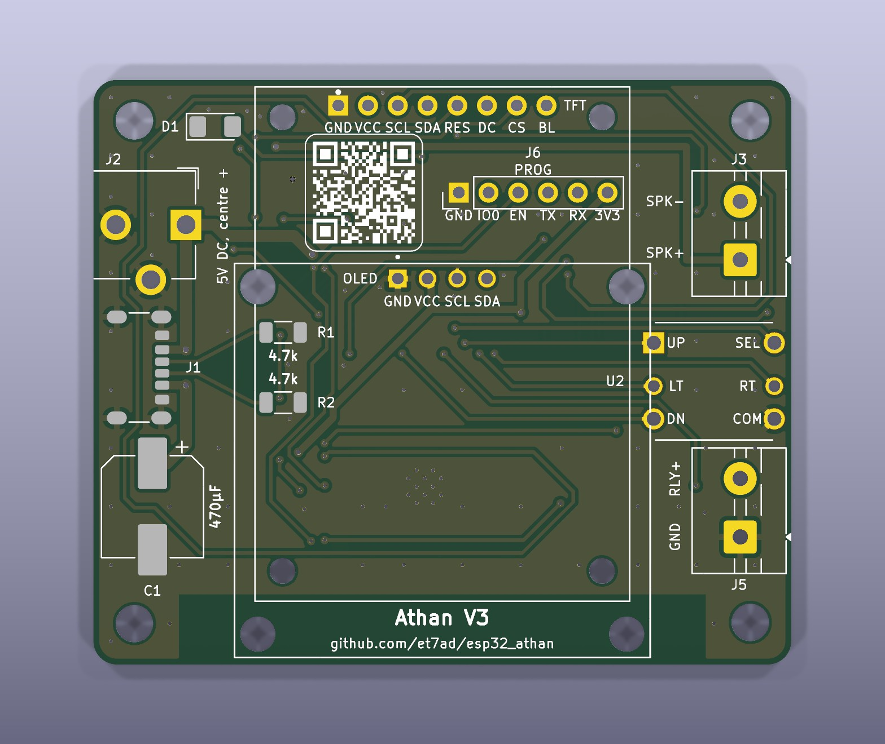
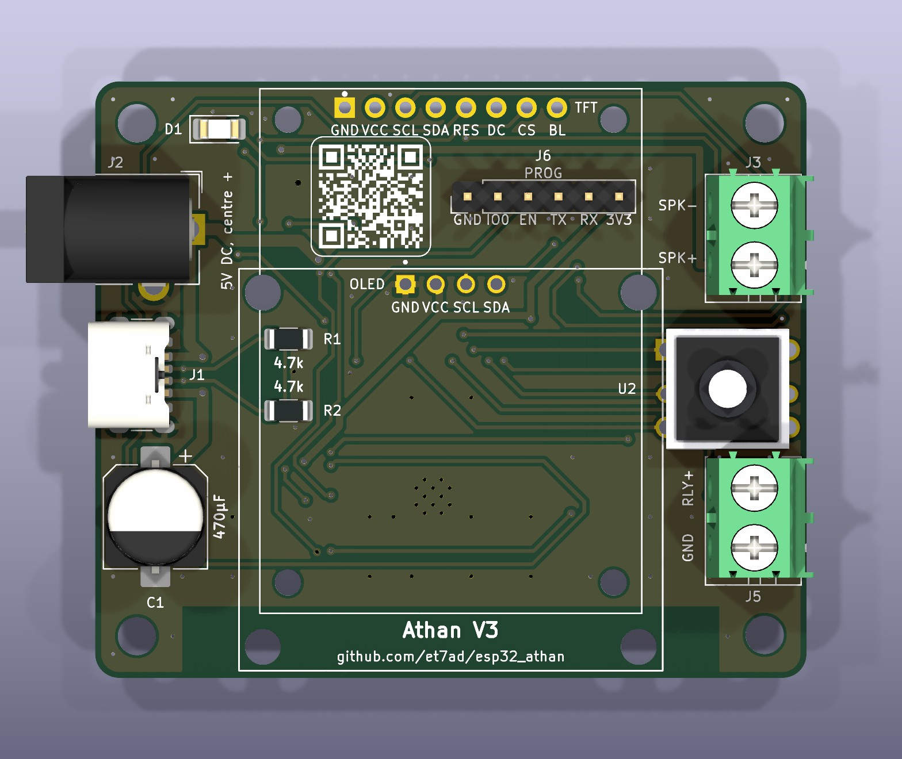
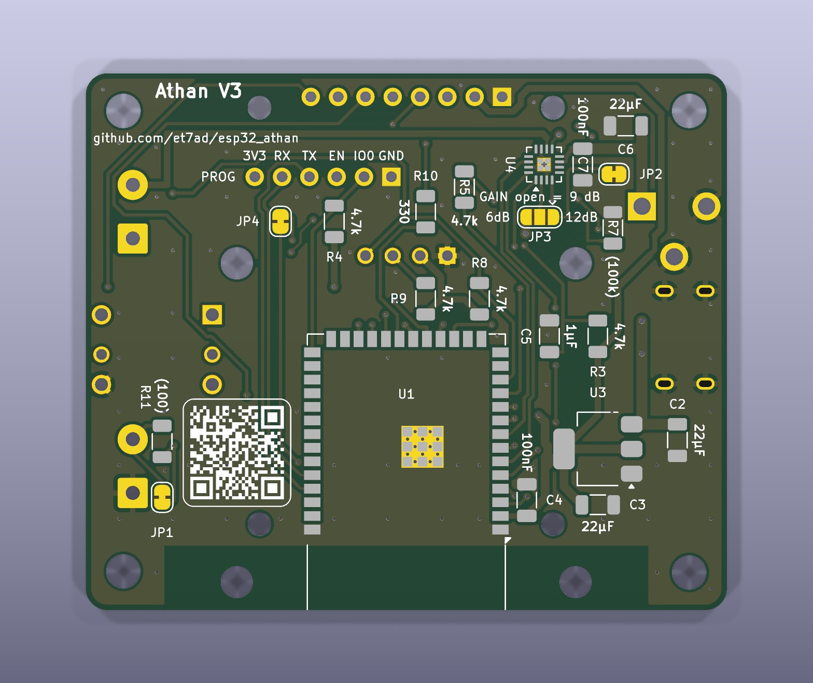
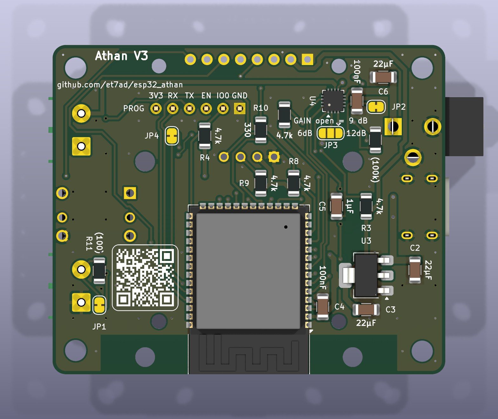
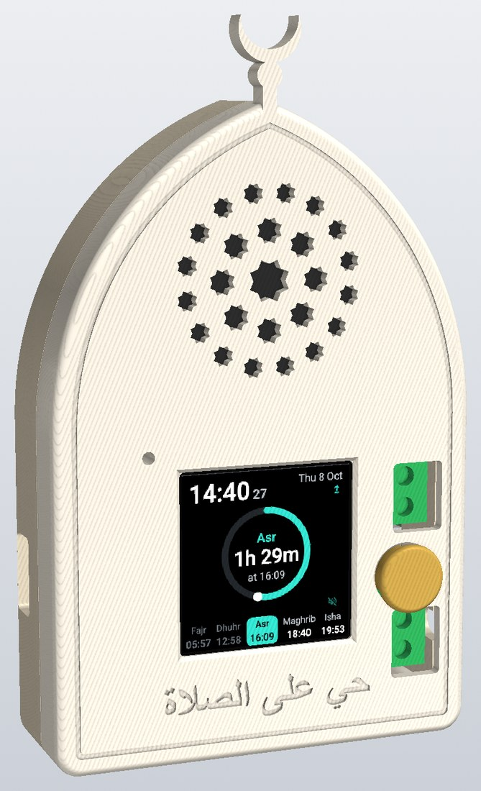

# Building a clock

How to build an athan clock: first a prototype on a breadboard, then the firmware, then the circuit board. The
board's design (circuit, pin map, parts list) is in [HARDWARE.md](../HARDWARE.md); using a finished clock is in
[using.md](using.md).

1. [What you need](#1-what-you-need)
2. [A prototype on a breadboard](#2-a-prototype-on-a-breadboard)
3. [Building the firmware](#3-building-the-firmware)
4. [Flashing it](#4-flashing-it)
5. [The circuit board](#5-the-circuit-board)
6. [First power-on of a new board](#6-first-power-on-of-a-new-board)
7. [Acceptance checklist](#7-acceptance-checklist)

## 1. What you need

| Part | Notes |
|---|---|
| ESP32-S3-WROOM-1-**N16R8** module (LCSC C2913202) | 16 MB flash and 8 MB PSRAM. Other variants lack the memory for the stored sounds |
| MAX98357A amplifier (MAX98357AETE+T, LCSC C910544) | Turns the I2S audio into up to 3 W for the speaker |
| A display: a 1.3" 128×64 I2C OLED (SH1106 or SSD1306), or a 1.54" 240×240 ST7789 IPS colour screen | One or the other; the firmware is built for the one you fit |
| 5-way switch, 10 × 10 mm through-hole (Alps SKQUCAA010 or a copy, sold as "5-way switch 10*10*10 mm") | Up, Down, Left, Right and a centre push |
| A 40 mm round 4 Ω 3 W speaker | The case holds a 40 mm speaker up to 16.5 mm deep (18.5 mm with the TFT) |
| Two 2.54 mm headers, 4 pins (OLED) or 8 pins (TFT): a standard male header and an 8.5 mm female header | The male one goes on the board, the female one on the display, which plugs onto the board as the case closes |
| The case: three printed parts, and 6 × M3 × 16 countersunk screws for extra hold | [hardware/enclosure/README.md](../hardware/enclosure/README.md) |
| USB-C receptacle (6-pin, power only), AMS1117-3.3 regulator, resistors and capacitors | The full list is in [HARDWARE.md](../HARDWARE.md) section 7. The board also takes a 5 V barrel jack, a fallback for a broken USB-C that the case has no room for |
| A 3.3 V USB-serial adapter (CP2102, or CH340 set to 3.3 V) | For the first flash through the board's 6-pin header J6 |

The relay output is a 3.3 V logic signal on a screw terminal, not a relay: use a relay module that switches on a
3.3 V input.

## 2. A prototype on a breadboard

Build this first. It runs the same firmware with the same pins and memory layout as the final board, so everything
in the checklist (section 7) can be tried before you order boards.

Parts: an **ESP32-S3-DevKitC-1 N16R8** (the same module on a development board), an **Adafruit MAX98357A
breakout (3006)** or a clone, the speaker, a display, the 5-way switch (or five push buttons), an LED with its
resistor (100 Ω for a blue, green or white LED, 330 Ω for red), and a 4.7 kΩ resistor for the amplifier's SD pin.

| DevKitC pin | Goes to | Notes |
|---|---|---|
| 5V | breakout **Vin** | The DevKitC's 5V pin carries the USB supply |
| GND | breakout **GND**, display GND, switch **COM**, LED cathode | Common ground |
| GPIO5 | breakout **BCLK** | |
| GPIO6 | breakout **LRC** | |
| GPIO7 | breakout **DIN** | |
| GPIO15 | 4.7 kΩ to breakout **SD** | See below |
| breakout **GAIN** | not connected (9 dB) | |
| breakout **+ / −** | the speaker | |
| GPIO14 | switch **Up** | The firmware turns on the internal pull-ups; the switch's COM goes to GND |
| GPIO10 | switch **Down** | |
| GPIO21 | switch **Left** | |
| GPIO47 | switch **Right** | |
| GPIO11 | switch **Select** (centre push) | |
| GPIO12 | relay module input (or an LED, to see it) | |
| GPIO13 | 100 Ω (blue LED) or 330 Ω (red), then the LED, then GND | Status LED |

The display, OLED (I2C):

| DevKitC pin | OLED pin |
|---|---|
| 3V3 | VCC |
| GND | GND |
| GPIO8 | SDA |
| GPIO9 | SCL |

Most OLED modules already carry their I2C pull-ups.

Or the colour screen (SPI). The modules label their SPI clock and data pins SCL and SDA:

| DevKitC pin | TFT pin |
|---|---|
| 3V3 | VCC |
| GND | GND |
| GPIO9 | SCL (clock) |
| GPIO8 | SDA (data) |
| GPIO16 | RES |
| GPIO17 | DC |
| GPIO18 | CS |
| GPIO4 | BLK (backlight) |

**The amplifier's SD pin:** wire GPIO15 through 4.7 kΩ to SD, as on the board. With GPIO15 high the amplifier
plays the left channel; with it low the amplifier is off and silent. Don't leave SD unconnected: the breakout then
mixes both channels and never switches off.

Flash the DevKitC over either of its USB ports and read its log on the one marked **UART** (section 4). Other
boards that could work, and what they would give up, are in
[microcontroller_demand.md](../microcontroller_demand.md).

## 3. Building the firmware

The firmware is built with [ESPHome](https://esphome.io) **2026.9.1**. It carries its own copy of that version's
speaker component (`firmware/components/speaker`), so it needs exactly this version; the component's README there
says how to move to another one.

The easiest way is **`./build_firmware.sh`** in the repository's root folder (macOS or Linux, with Python 3.12, 3.13
or 3.14). On its first run it installs that ESPHome into its own environment, with no Docker or dashboard. ESPHome,
its toolchain (about 1 GB) and the build files live in `~/.cache/esp32_athan`; only the finished files land in the
repository, in `firmware/binaries/`.

| Command | What it does |
|---|---|
| `./build_firmware.sh` | Builds. Writes `athan-v3-<version>.factory.bin`, `athan-v3.ota.bin` and `manifest.json` to `firmware/binaries/` |
| `./build_firmware.sh flash [PORT]` | Builds, then flashes over a serial port: the board's J6 adapter (`/dev/cu.usbserial…`) or a DevKitC's USB (`/dev/cu.usbmodem…`). Without PORT it lists the ports |
| `./build_firmware.sh ota [HOST]` | Builds, then updates a clock over Wi-Fi (`athan.local` if you give no host) |
| `./build_firmware.sh logs [PORT\|HOST]` | Shows the clock's log |
| `./build_firmware.sh check` | Checks the configuration only (a few seconds, no build), for both displays |
| `./build_firmware.sh clean [all]` | Deletes the build files (`all` also deletes ESPHome and the toolchain) |

Before the first build:

1. **The menu tones.** `firmware/sounds/` holds `click.wav` (the menu click) and `volume.wav` (the volume tone):
   short mono 16-bit 44.1 kHz WAV files, under about 50 ms each. The repository has a pair. To make your own from
   any sound file:

   ```bash
   ffmpeg -i in.mp3 -ac 1 -ar 44100 -c:a pcm_s16le -map_metadata -1 -fflags +bitexact click.wav
   ```

2. **Your own encryption key (recommended).** Generate one with `openssl rand -base64 32` and put it in both the
   `api:` and `ota:` sections of `firmware/athan.yaml`. You don't need Wi-Fi details or a `secrets.yaml`: Wi-Fi is
   set up from a phone (using.md section 1).

**Which display.** The firmware is built for one display: the one-colour OLED (the default) or the colour TFT. Add
`--display tft` to any command above for the TFT, or set `display_type: tft` at the top of `firmware/athan.yaml`;
the script follows the yaml whenever `--display` is not given. The TFT build's files carry `-tft` in their names
(`athan-v3-tft-<version>.factory.bin`, `athan-v3-tft.ota.bin`, `manifest-tft.json`), and a TFT clock only updates
to TFT releases. A clock flashed with the other display's build runs with a dark screen.

ST7789 modules differ a little. A new TFT clock opens on its Wi-Fi setup screen, where the Wi-Fi icon is teal and
"Press Select" is orange. If they look yellow-green and blue, or the background is white, change the panel
settings at the top of `firmware/displays/tft.yaml` (each one is explained there).

**Logging.** How much the clock logs is `log_level` at the top of `firmware/athan.yaml`: `DEBUG` while you test,
`WARN` or `NONE` for a finished clock.

**The ESPHome dashboard instead of the script:** copy the contents of `firmware/` into the dashboard's config
folder (`athan.yaml`, `partitions.csv`, `web_audio_link.js`, `components/`, `displays/` and `sounds/`). The yaml
finds them by relative path. Use the 2026.9.1 image: `docker pull esphome/esphome:2026.9.1`.

**An older clock on the same network.** Version 2 clocks are also called `athan`. Give one of them another
`device_name` (a substitution at the top of the yaml, for example `athan3`), or `athan.local`, Home Assistant and
the dashboard will mix them up. In a shared dashboard config folder, also save the yaml under another file name.

## 4. Flashing it

### The first flash

On a DevKitC, plug in its USB port and run `./build_firmware.sh flash`; it enters download mode by itself.

The board's USB-C only supplies power, so its first flash goes through the 6-pin header J6 with a 3.3 V
USB-serial adapter. This flash also writes the bootloader and the memory layout:

1. Wire the adapter: GND to J6 pin 1, the adapter's RX to pin 4, its TX to pin 5.
2. Put the jumper cap on J6 pins 1 and 2 (this holds GPIO0 low), then plug the board's USB-C into a charger.
3. Flash, choosing the adapter's port:

   ```bash
   ./build_firmware.sh flash        # or, with your own ESPHome: esphome run firmware/athan.yaml
   ```

4. Remove the jumper, then unplug and replug the USB-C.

Without a header on J6, the programmer in `hardware/programmer/` drops into J6's holes unsoldered and holds GPIO0
low itself. Wire GND, TX, RX and 3V3 to it, push it into J6 (GND to GND), and the clock starts in download mode from
the adapter's 3.3 V: [hardware/programmer/README.md](../hardware/programmer/README.md).

The log comes out on the same adapter (UART0, J6 pins 4 and 5): `./build_firmware.sh logs /dev/cu.usbserial-…`.

### Without building: a release, flashed from the browser

Each GitHub Release carries a ready-made factory file for each screen: `athan-v3-tft-<version>.factory.bin` for the
colour screen and `athan-v3-<version>.factory.bin` for the OLED. [ESPHome Web](https://web.esphome.io) flashes one
from Chrome or Edge on a computer, with nothing to install:

1. Download the factory file for your screen from the
   [Releases page](https://github.com/et7ad/esp32_athan/releases).
2. Connect the clock as for the first flash above: the adapter on J6 with the jumper on pins 1 and 2 (or the press-in
   programmer), or a DevKitC's USB.
3. Open <https://web.esphome.io>, press **Connect**, and choose the adapter's port.
4. Choose **Install** and pick the factory file. When it is done, remove the jumper and power the clock from its USB-C.

The factory file writes the whole flash, so the clock starts afresh, Wi-Fi and settings included.

### Later updates

Once the clock is on Wi-Fi, flash it over the network with `./build_firmware.sh ota`. Clocks also update themselves
from this project's GitHub Releases ([maintaining.md](maintaining.md) section 5).

`flash` and `ota` always build first. To send files that already exist (your last build, or files downloaded from a
GitHub Release) without building, use **`./flash_firmware.sh`**:

| Command | What it does |
|---|---|
| `./flash_firmware.sh ota [HOST]` | Sends `firmware/binaries/athan-v3.ota.bin` over Wi-Fi. Keeps the settings, Wi-Fi, sounds and prayer times |
| `./flash_firmware.sh usb [PORT]` | Sends the same file over a serial port (the J6 adapter or a DevKitC's USB). Keeps everything. For a clock that already runs this firmware |
| `./flash_firmware.sh usb-full [PORT]` | Writes the whole `athan-v3-<version>.factory.bin` from the start of the flash: for a blank board, or after `firmware/partitions.csv` changed. Erases the settings and Wi-Fi |

Add `-f FILE` to send another file, and `--display tft` for the TFT build's files. Both scripts check every file
first. Over Wi-Fi they only send to a version 3 clock running the same display's build: a version 2 clock also
answers to `athan.local`, and the wrong build would leave a dark screen. `--any-display` skips the display check.

### The first start

On its first start with internet, the clock downloads its prayer times, then its default sounds: entry 1 of the
athan, Fajr and tick lists in [docs/audio/catalog.json](../docs/audio/catalog.json). The tawashih is Random by
default and streams when it plays, so nothing is downloaded for it. Until the sounds are stored, an athan time is
marked with three tones.

## 5. The circuit board

The KiCad project is in `hardware/pcb/`. The board is 59.6 × 50 mm, with two layers, and every part is soldered by
hand.

- **The front** (the side you look at) carries the header for one display (the TFT or the OLED, which plugs onto it
  9.3 mm above the board, so the small parts fit under it), the 5-way switch, the status LED, the USB-C, and the
  screw terminals for the speaker and the relay. The USB-C can go on the back instead: its pads are on both sides.
- **The back** carries the ESP32 module (its antenna at the bottom edge, with no copper under it), the amplifier,
  the regulator and the small parts.
- Every resistor and capacitor has its value printed next to it, and the programming header J6 is labelled on both
  sides.

| Side | Bare board | Assembled |
|---|---|---|
| Front |  |  |
| Back |  |  |

**Ordering.** In `hardware/pcb/`, `./generate_fab_files.sh` makes every file from the saved project, without
opening KiCad: the Gerbers and drill files (`fab_files/athanV3.zip`), the parts lists, the 3D model, and the BOM and
pick-and-place files for JLCPCB to assemble the board. Order a two-layer board, 1.6 mm thick, with lead-free HASL
or ENIG (ENIG makes the amplifier's small pads easier to solder). The parts and their numbers are in
[HARDWARE.md](../HARDWARE.md) section 7; ordering the board assembled is in [jlcpcb_assembly.md](jlcpcb_assembly.md).

**Soldering.**
- Start with the back: the amplifier (its exposed pad underneath needs hot air or a hot plate), the module, the
  regulator and the small parts.
- Then the front: the switch, the terminals, the LED and the large capacitor C1 (at most 10.5 mm tall, for the case).
  The barrel jack J2 stays off a board that goes in the case.
- The USB-C J1 goes on either side; the case has a back for each.
- The display's header: a male header pushed in from the back at DS1 (OLED) or DS2 (TFT), soldered on the front,
  its short ends cut off under the plastic. The display gets the matching female header and clicks into the case's
  front; it plugs onto the board as the case closes. With the TFT, J6 sits under the display: leave it without a
  header and flash with the press-in programmer (section 4).

**Jumpers.** The solder jumpers on the back come set for a normal clock:
- The amplifier's gain is 9 dB. To change it, see [HARDWARE.md](../HARDWARE.md) section 4.
- JP4 lets the firmware dim the TFT's backlight. Cut it to keep the backlight at full brightness.
- JP1 connects the relay output. Cut it and fit R11 to put a resistor in series.

**The case.** The board goes in a 3D-printed case shaped like a mihrab, with the speaker behind a star grille in
the arch. The board clicks into the back, the display into the front, and the front onto the back. What to print,
the parts it needs and how it goes together are in [hardware/enclosure/README.md](../hardware/enclosure/README.md).



## 6. First power-on of a new board

1. Before you plug it in, check +5V and +3V3 against GND with a meter for shorts.
2. Flash it through J6 (section 4).
3. Read the log on the same adapter: `./build_firmware.sh logs /dev/cu.usbserial-…` (115200 baud). Look for
   `Athan:` in the configuration it prints, and `Slot athan: (empty)` on a new board. An OLED clock also reports its
   display at address 0x3C. Once Wi-Fi is set up, `./build_firmware.sh logs athan.local` works without the adapter,
   and updates go over Wi-Fi.
4. Set up its Wi-Fi ([using.md](using.md) section 1). The default sounds download within minutes. Play one from the
   menu at 10 %, then raise the volume and listen for distortion: that tells you whether to change the gain.
5. Run the checklist below on the first boards.

## 7. Acceptance checklist

Run it on the breadboard prototype before ordering boards, and again on the first boards. The firmware assumptions
behind these checks are listed in [DEVELOPER.md](../DEVELOPER.md) section 11; the amplifier's own checks are in
[max98357a_amplifier.md](../max98357a_amplifier.md) section 7.

1. **Size.** The firmware fits its 0x360000-byte app slots (`firmware/partitions.csv`; it is about 1.8 MB).
2. **Wi-Fi setup, both ways** (using.md section 1):
   - Bluetooth from Chrome on Android (improv-wifi.com) and from the Home Assistant app. The Select confirmation
     works, and Bluetooth turns off after joining.
   - The hotspot from an iPhone. It appears after 3 minutes.
   - A new clock and a clock whose saved network went away both reach setup (Bluetooth after 15 s). When the saved
     network returns, the clock reconnects by itself.
   - Enough free internal memory with Bluetooth and the hotspot on and a stored athan playing.
3. **Downloads.** Each sound downloads from the list. A sound stays as it was after: pulling the network halfway,
   a file over the size limit (3 MB, tick 0.4 MB), a file over the length limit (5 min, tick 1 min), and a file
   that is not an MP3. The sounds page shows the reason.
4. **Uploads** from the sounds page, with the same four failures.
5. **A power cut while a sound is saved.** That sound counts as empty, its athan time is marked with three tones,
   and its default downloads again once the clock is online (at most every 30 minutes).
6. **Playback.** The athan, Fajr athan, tawashih and tick play from flash at every volume from 10 to 100 %, with no
   hiss while idle. Pre-Fajr Tawashih, switched on from the web page, Home Assistant and the menu, starts 25
   minutes before Fajr with the relay on, and the relay goes off 15 minutes after the tawashih.
7. **Radio.** An mp3quran station plays for an hour without dropouts. Empty slots are skipped. A slot that follows
   the project's list picks up a changed link in `docs/radio/stations.json` within 6 hours. An own link plays. After
   a router restart the stream comes back by itself (the clock gives up after 10 minutes).
8. **Radio and the other sounds.** An athan pauses the radio, and the same station comes back when the athan ends;
   the Pre-Fajr Tawashih does the same. Stopping the athan leaves the radio off. An hourly tick plays over the
   lowered radio, and the radio is back at full level afterwards.
9. **Controls.** The web page, Home Assistant, the screen and the switch respond while a stream plays, and memory
   stays steady over hours. Each direction of the switch does what its name says as you face the clock (if not,
   swap the pins in the yaml). Every menu row works. Browsing quickly through the menu never restarts the clock.
   Left and Right change the volume of a playing athan and of the radio without stopping them. Up toggles the
   radio, Down the relay. Both power-up gestures work (using.md sections 1 and 3). Everything on the screen is
   readable. The menu goes round, and Exit returns to the clock.
10. **Updates.** An update from a GitHub Release installs. A version 2 clock does not see it.
11. **Power.** Measure the 5 V current at full volume. There are no resets at full volume, no Wi-Fi buzz in the
    speaker, and the gain is set (HARDWARE.md section 4).
12. **Prayer times:**
    - The scripts build a yearly file for every published year, and the clock accepts it.
    - Once the clock is set, two days with the router unplugged do not stop a single athan.
    - Choosing another mosque downloads its year.
    - With the clock's date set to 1 December, the next year is fetched; on 1 January it is used.
    - With no next-year file on the server, "not found" shows no error. From 1 January the estimated times are
      used (the mark on the screen, "[estimated]" on the web page) and the athan plays. Publishing the file
      switches the clock over within 6 hours.
    - Estimated dates inside daylight saving time (for example 10 March) come out right, not an hour off.
    - A brand-new clock in early January with no stored year fetches last year's times for the estimate.
    - A broken file (wrong year, a missing day, times out of order) is refused, and the stored year stays.
    - After a power cut without internet, the screen shows the last day's times struck through, and the clock
      recovers by itself when the internet returns.
13. **The colour screen** (a TFT build):
    - The Wi-Fi setup screen shows a teal icon and an orange "Press Select" on black. If not, set
      `tft_color_order`, `tft_invert` and `tft_offset_height` in `firmware/displays/tft.yaml`.
    - The ring, the strip, the menu's icons and the pop-ups match the
      [design page](https://claude.ai/artifact/XttPFXwoSqycdCdLjbHLoi) (clock C, menu M1, Teal).
    - Every icon shows; a missing one would show as an empty box.
    - Screen Colour changes the accent colour at once.
    - Unplugged and plugged back in while the clock runs, the screen comes back in its own colours within 30
      seconds, or at once with a key press. While it stays plugged in, nothing on it flickers every 30 seconds.
    - A TFT clock offers only TFT releases (`manifest-tft.json`), and an OLED clock only OLED ones.
14. **Screen settings,** on both displays:
    - Brightness at 10 % is readable in a dark room, and 100 % in daylight. 0 % turns the screen dark at once.
    - Screen at Night Dim and Turned off switch at Night From, and back at Night Until.
    - While the screen is dark, the first key press only lights it (dim) for 2 minutes, with the seconds counting
      down in a corner. The athan and the Pre-Fajr Tawashih light it while they play.
    - The dim level (`screen_dim_pct`, 10 %) and the wake time (`screen_wake_s`, 120 s) may need tuning for the
      real backlight.
