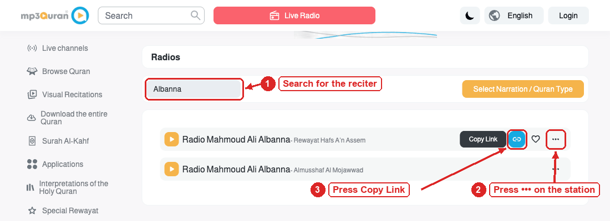
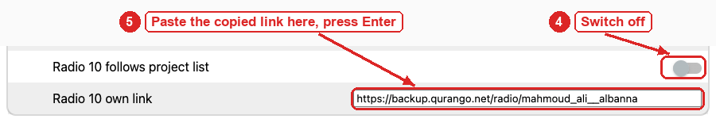
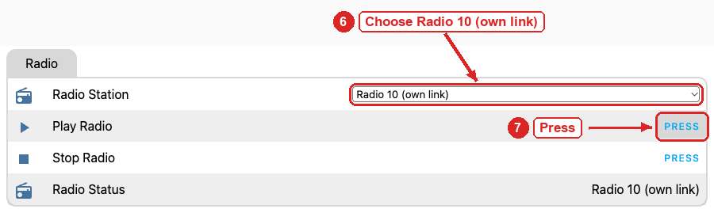

# Using the clock

How to set up an athan clock, read its screen, use its buttons and web page, change its sounds, and play Quran
radio. Building a clock is in [building.md](building.md).

1. [First setup](#1-first-setup)
2. [The screen](#2-the-screen)
3. [Buttons and the menu](#3-buttons-and-the-menu)
4. [The web page](#4-the-web-page)
5. [Sounds](#5-sounds)
6. [Radio](#6-radio)
7. [Prayer times](#7-prayer-times)
8. [Updates](#8-updates)

## 1. First setup

**Power.** Plug the clock into a USB-C charger (5 V, 2 A). The board also has a barrel jack for a regulated 5 V
supply, centre positive. Use one or the other, and never more than 5 V.

**Wi-Fi.** A new clock, or one that cannot find its saved network, offers two ways to connect it. Use whichever
suits your phone; the first one to finish wins. The clock joins **2.4 GHz** Wi-Fi only. A router that sends 2.4 GHz
and 5 GHz under one network name works; a network that is 5 GHz only does not.

### Way 1: Bluetooth (Android, computers, the Home Assistant app)

1. On an Android phone or a computer, open Chrome or Edge, go to <https://www.improv-wifi.com>, press **Connect**
   and pick the device named **athan**. If you use Home Assistant, its Companion app finds the clock by itself and
   offers to set it up.
2. When the screen shows **BT: press Select**, press **Select** on the clock (push the joystick straight in). This
   proves you are standing next to it. The permission lasts one minute.
3. Choose your network and type its password. The clock joins, and Bluetooth turns off.

### Way 2: the clock's own hotspot (every phone, including iPhone)

iPhones need this way, unless you have the Home Assistant app: Safari has no Web Bluetooth.

1. In your phone's Wi-Fi list, join **AthanFallbackHotspot**. The password is **athan404**.
2. The setup page opens by itself. If it doesn't, open <http://192.168.4.1>.
3. Pick your network, type the password and save. The clock restarts and joins.

### After setup

On a new clock both ways start at once. When a saved network goes away, Bluetooth starts after 15 seconds and the
hotspot after about 3 minutes, so a short router restart never opens the hotspot.

**To forget the saved Wi-Fi,** unplug the clock, hold **Select**, and plug it back in. The LED blinks three times,
the clock restarts, and setup starts again (Bluetooth after 15 seconds, the hotspot after about 3 minutes).

**Your mosque.** A new clock starts with the first mosque in the list (Davis). Choose yours in the menu
(**Location**) or on the web page. The clock downloads that mosque's prayer times for the year, then its default
sounds. That takes a few minutes the first time.

## 2. The screen

Clocks come with one of two screens: a small one-colour OLED, or a 1.54" colour screen. Both show the same things.

### The one-colour screen

```text
15:42        ▸ 8 🔒 THU       the time; status marks and the weekday
               8 Oct          the date
 Fajr Dhuhr [Asr] Magh  Isha  the day's five prayers; the next one highlighted,
05:57 12:58 [16:09] 18:40 19:53   its time a size up
╭ Asr                       ╮ the next prayer (small) and its time,
╰ 16:09         in 27 min   ╯ and the time left (large)
```

| What you see | What it means |
|---|---|
| A small hollow square, top right | Estimated times. This year's timetable is not published yet, so the clock uses last year's times for the same date, converted for daylight saving (at most about a minute off). It goes away when the real timetable arrives. Mosques often publish late, sometimes into January |
| A prayer's name struck through | The athan for that prayer is switched off |
| Dhuhr in an outline instead of a filled box | Sunrise or Doha comes first. They have no column; the bottom box names them |
| A small triangle with a number, top right | The radio is playing. The number is the radio slot (1 to 10); **Up** stops it |
| A padlock, top right | The buttons are locked (section 3) |
| A crossed-out Wi-Fi sign, top right | No Wi-Fi. The athan keeps working from the stored times |
| A small up arrow over a line, top right | A firmware update is ready to install (section 8) |

With the 12-hour clock, AM or PM shows next to the large time and next to the prayer time in the bottom box; the
table's times are plain (5:57, 4:09). The time left reads "in 27 min" under an hour and "in 2h 20m" above. When the
box is short of room it shortens to "in 2h20m" or "in 27m". The weekday hides when the status marks fill the space
beside the time.

Other screens:
- **During the athan,** the bottom box turns white with the prayer's name large and ATHAN TIME beside it.
- **For 2 seconds after Left, Right or Down,** a box over the clock shows the volume with a bar, or Relay ON/OFF.
- **Before the clock knows the time** (for a few seconds after it powers up and joins Wi-Fi), the time shows
  `--:--`. After a power cut the table shows the last day's prayer times struck through until the clock is set
  again.
- **During Wi-Fi setup,** the screen shows the Bluetooth state (`BT: press Select`, `BT: allowed`,
  `BT: joining..`), the page to open for Bluetooth setup, and whether the hotspot is on.

### The colour screen

- **At the top:** the time with its seconds, and the date. On the right, the status marks: a radio with the slot
  number, an up arrow for a firmware update to install (section 8), a padlock, a crossed-out Wi-Fi sign, and a
  clock with an arrow for estimated times.
- **In the middle:** a ring that fills from the last prayer to the next one. Inside it are the next prayer, the time
  left ("1h 29m", "37m", and in the last minute the seconds, "45s") and the prayer's time.
- **At the bottom:** the five prayers in a strip. The next one sits in a filled box, easy to find from across a
  room. When Sunrise or Doha comes first, Dhuhr is only framed. Prayers that have passed are dimmed.
- **An athan switched off** shows a mute icon above that prayer's name.
- **In the last minute before an athan,** the ring flashes, half a second on and half a second off, while the
  time left counts down the seconds.
- **During the athan,** the ring and the prayer's box turn the athan colour, and the ring shows the prayer's name
  and ATHAN TIME.
- **During Wi-Fi setup,** the screen also shows the hotspot's name and password.
- **Colours:** choose them with **Screen Colour**: Gold, Teal (the default), Green, Blue or White.

## 3. Buttons and the menu

The clock has one 5-way joystick: **Up**, **Down**, **Left**, **Right**, and **Select** (push it straight in).

On the clock screen:

| Key | What it does |
|---|---|
| Left / Right | Volume down or up by 10 %, shown for 2 seconds. It changes the volume of whatever is playing (the Fajr volume during the Fajr athan or the tawashih). With nothing playing, a short tone plays at the new volume. The keys stop at 10 %; to go silent (0 %), use the menu or the web page |
| Up | Radio on or off. It plays the station you chose last (its number shows beside the play mark) |
| Down | Relay output on or off |
| Select | Opens the menu |

While the athan, the tawashih, the tick or a sound preview plays, **Up**, **Down** and **Select** stop it instead. The
radio keeps playing. If you stop the athan, the radio it paused stays off.

**A dark screen.** When the screen is dark (Brightness at 0 %, or **Screen at Night: Turned off** during the night),
the first press of any key only lights it, dimly. It stays lit for 2 minutes after your last press, and a small tab
with a moon counts the seconds down. The athan and the Pre-Fajr Tawashih light the screen too; the 2 minutes start
when they end.

### The menu

The menu has two panes. The left pane lists the rows, five at a time, by a short name; Up and Down move through
them. The list goes round: Down on the last row (Exit) brings you back to Radio. The right pane shows the row's full
name and its current choice; Left and Right move through the choices. A check mark shows what is in use, and a
play mark shows the radio station that is playing.

**Select** takes the choice shown. Where there is nothing to take (the choice already in use, a volume, Info), it
closes the menu. **Exit** returns to the clock with Select, Left or Right, and so does a minute without a press.

Short names in the left pane: Fajr = Fajr Athan, Tawsh = Tawashih, Tick = Hourly Tick, On/Off = Athan On/Off, Vol =
Volume, Masjid = Location, Bright = Brightness, Night = Screen at Night, Colour = Screen Colour, Lock = Lock Buttons.
Rows that belong together share a small icon: a clock on the tick rows (Tick, and its From and Until), a speaker on
Athan On/Off and the volumes (so "Fajr" with a speaker is Fajr Volume), a sun on Bright, and a moon on Night and
its From and Until. The colour screen shows an icon on every row and the full names where they fit.

| Row | Left / Right | Select |
|---|---|---|
| Radio | The ten radio slots | Plays the slot shown (or stops it if it is playing) and returns to the clock |
| Athan | The suggested athans, numbered ("1. Athan 1", "2. Abdul Basit", and so on), with **Custom** first if you uploaded one. Rest on one for half a second and it plays a preview. With the radio on, only Left and Right start a preview, and the radio comes back when the menu closes | Downloads the athan shown and makes it the athan. Progress shows under it. Your current athan stays until the new one has passed every check |
| Fajr Athan | The same, for Fajr. Previews play at the Fajr volume | The same |
| Tawashih | **Random** first (the default: a different one from the list every day, streamed, so nothing is stored), then the list | Random takes effect at once. A list entry is downloaded as for the athan and replaces Random |
| Pre-Fajr | Off, On | Takes it |
| Hourly Tick | The ticks, with **Off** first | Takes it; choosing a tick switches the hourly tick on |
| Tick From, Tick Until | When the tick plays during the day. From: Fajr, Dhuhr, or an hour. Until: Maghrib, Isha, or an hour. A prayer moves with the prayer times every day. The line under it shows the result ("until Isha, 14 h"); the same From and Until means all day | Takes it |
| Athan On/Off | Each prayer with On or Off; under them, all five by their first letter, with a filled box when the athan is on | Switches the prayer shown |
| Volume, Fajr Volume | 0 to 100 %, applied at once, with a tone at the new level | Closes |
| Location | The mosques | Takes it; the clock downloads its prayer times |
| Clock | 24-hour, 12-hour | Takes it |
| Brightness | 0 to 100 %, applied at once. At 0 % the screen goes dark, by day too | Closes |
| Screen at Night | **Normal** (the same as by day), **Dim**, or **Turned off**, between Night From and Night Until | Takes it |
| Night From, Night Until | The night: From: Maghrib, Isha, or an hour. Until: Fajr, Dhuhr, or an hour. The line under it shows the result ("until Fajr, 10 h") | Takes it |
| Screen Colour (colour screen only) | Gold, Teal, Green, Blue, White | Takes it |
| Update | | When the clock knows of new firmware (the up arrow on the screen), the row shows **Install 3.x.y**, and Select installs it. Otherwise Select checks GitHub now. "Check failed" means there is no release yet or the clock is offline; "Install failed: try again" means an install did not finish and nothing changed |
| Lock Buttons | | Locks the buttons and returns to the clock |
| Info | The clock's IP address, `athan.local` and the firmware version | Closes |
| Exit | | Returns to the clock |

**Locking the buttons** is handy when children can reach the clock. While locked, any key only stops what is
playing. To unlock, switch off **Buttons Locked** on the web page, or unplug the clock and plug it back in while
holding any of the four directions (the LED blinks three times quickly). Holding Select instead forgets the Wi-Fi
(section 1).

## 4. The web page

Open <http://athan.local>. If that doesn't work, use the IP address from the menu's **Info** row. The page is
grouped:

- **Now:** Stop Audio, Athan Playing, Next Prayer, Today's Times, Buttons Locked, 12-hour Clock.
- **Athan:** Volume, Fajr Volume, Pre-Fajr Tawashih, Hourly Tick, Tick Window Start and End, and Tick Window, the
  window they make ("Fajr to Isha (14 h)", "all day", "tick off").
- **Athan On/Off per Prayer:** a switch for each prayer.
- **Sounds:** the sounds in use, the last download's status, and the link to the sounds page (section 5).
- **Radio:** Radio Station, Play Radio, Stop Radio, Radio Status.
- **Radio Stations:** the ten slots (section 6).
- **Location and Prayer Times:** Location, Refresh Prayer Times, and Prayer Data (which years are stored).
- **Screen:** Screen Brightness, Screen at Night, Night From, Night Until, Night Window (the night they make), and
  Screen Colour on a colour-screen clock.
- **System:** Firmware Version (and whether a newer one is out), Firmware (installs updates), Check For Update,
  Restart, External Relay, IP address, Wi-Fi Signal, Wi-Fi Drops (the last three times the router dropped the
  clock, and why), and memory.

Everything the menu and the keys do can also be done here, except forgetting the Wi-Fi. Choosing, previewing and
downloading sounds is on the sounds page (section 5).

The same controls appear in Home Assistant: its ESPHome integration finds the clock by itself. When it asks for the
encryption key, use `/A5YakHWYfXLiBWI5Z92v0FWiaMsWbCUCWD41zlLPYk=`.

## 5. Sounds

Open <http://athan.local/audio>, or follow **Change Sounds At** on the main page. A status bar stays at the top of
the page and reports every button, so the page never reloads or jumps back to the top. Its **Stop** button stops
what is playing (a preview, the Pre-Fajr Tawashih, the athan or the tick), like Up, Select or Down on the clock;
the radio keeps playing. After a download or an upload, the bar offers **Reload page** to show the new sound.

For each of the four sounds (athan, Fajr athan, tawashih, hourly tick) the page shows:

- **In use:** the sound stored on the clock, with its number and name in the list ("8. Jazy") and its length.
- **The list:** every sound this project suggests, numbered, in one dropdown. It opens on the sound in use, marked
  ✔. Choose one, then:
  - **Preview** to listen. Nothing is stored: the sound in use plays from the clock, any other streams from the
    internet.
  - **Download** to make it the sound in use. The clock downloads it, checks it, and only then replaces the old
    one. The status bar then says, for example, "8. Jazy downloaded and in use".
- **Upload your own:** pick an MP3 file on your phone or computer and press **Upload**. It then shows as **Custom**
  at the top of the dropdown and in the clock's menu, until you download a list entry for that sound.
- **Tawashih only: Random.** The first line of the tawashih list. With **Download**, the Pre-Fajr Tawashih becomes
  a different list entry every day, streamed when it plays. It is the default. Downloading or uploading a tawashih
  switches Random off. Random needs internet at Pre-Fajr time; without it nothing plays (the relay still
  switches).

A sound that fails to download, or a file that is too big, too long or not an MP3, never replaces the sound in use.
The status bar says why. A sound can't be replaced while it is playing.

**Limits:**

| Sound | Largest file | Longest |
|---|---|---|
| Athan, Fajr athan, tawashih | 3 MB | 5 minutes |
| Hourly tick | 0.4 MB | 1 minute |

MB here is 1,000,000 bytes, as macOS shows sizes; Windows shows 3 MB as 2.86 MB.

The file must be an MP3. A 5-minute recording fits in 3 MB at 64 kbps mono.

**The clock plays only the left channel.** A mono file always plays in full. A stereo file plays only its left
channel, so anything only on the right (a voice, an echo) is lost. Converting the file to mono, as below, makes any
recording safe.

### The quick way: an online converter

1. Open [online-convert.com's MP3 converter](https://audio.online-convert.com/convert-to-mp3) and choose your file.
   It also takes WAV, M4A or a video.
2. In the optional settings, set **Change audio channels** to **Mono** and **Change audio sample rate** to
   **44100 Hz**. Set the bitrate to **64 kbps** (48 kbps for an hourly tick).
3. Convert, download the result, and upload it on the clock's sounds page.

Your file goes to that service's servers. To keep it on your computer, or to cut a long recording to the limit,
use ffmpeg instead.

### With ffmpeg, on your computer

1. Install [ffmpeg](https://ffmpeg.org) once: `brew install ffmpeg` (macOS), `winget install ffmpeg` (Windows) or
   `sudo apt install ffmpeg` (Debian, Ubuntu).
2. See what the file is:

   ```bash
   ffprobe -v error -show_entries stream=channels,sample_rate:format=duration,size -of default=nw=1 in.mp3
   ```

   `channels=1` is mono, `channels=2` is stereo. `duration` is in seconds and `size` in bytes; compare them with
   the limits above.
3. Convert it to mono. This mixes both channels into one, so nothing from either side is lost:

   ```bash
   ffmpeg -i in.mp3 -map 0:a -map_metadata -1 -ac 1 -ar 44100 -b:a 64k out.mp3
   ```

   | Part | What it does |
   |---|---|
   | `-map 0:a -map_metadata -1` | Keeps only the audio, without cover art or tags |
   | `-ac 1` | One channel: mono |
   | `-ar 44100` | 44.1 kHz, the clock's own rate |
   | `-b:a 64k` | 64 kbps: 5 minutes is about 2.4 MB. For an hourly tick use `-b:a 48k` |

   The input can be anything ffmpeg reads (WAV, M4A, a video). The output is MP3 because its name ends in `.mp3`.
4. If the mono version sounds hollow or thin, or one channel is only noise, keep one channel instead of mixing:
   replace `-ac 1` with `-af "pan=mono|c0=c0"` for the left channel, or `-af "pan=mono|c0=c1"` for the right one.
5. If it is longer than the limit, add `-t 300` (5 minutes), or `-t 60` for a tick, before `out.mp3`.
6. Run the `ffprobe` command from step 2 on `out.mp3`. It should say `channels=1` and fit the limits. Then upload
   it.

## 6. Radio

The clock has ten radio slots. Each slot has two settings on the web page, under **Radio Stations**:

- **Radio N follows project list** (on by default): the slot plays station N of this project's list,
  [docs/radio/stations.json](../docs/radio/stations.json). When a station moves, the project updates the list,
  and every clock follows within 6 hours.
- **Radio N own link:** switch "follows project list" off and paste a stream link here. The screen then shows "own
  link" for that slot.

Play a slot from the menu (**Radio**), with **Up** on the clock (the slot chosen last), or with **Radio Station**
and **Play Radio** on the web page. The Radio Station list shows each slot's station name ("Radio 1 Cairo Quran"),
or "(own link)". If a name you expect is missing, reload the page.

How the radio behaves:
- **At prayer time** the athan pauses the radio, and the same station comes back when the athan ends. The Pre-Fajr
  Tawashih does the same. If you stop the athan yourself, the radio stays off.
- **The hourly tick** plays over the radio, which is turned down for that moment.
- **If Wi-Fi drops,** the radio pauses and starts again by itself when Wi-Fi is back. After 10 minutes without
  Wi-Fi it switches off. Pressing Up while Wi-Fi is down starts the radio once it is back.
- **If a station fails** (it is down, or the router has no internet), the clock tries again a few times over about
  15 seconds, then stops and shows the reason under **Radio Status**.

### More Quran stations from mp3quran.net

The project's list fills the ten slots, but any slot can play another station instead.
[mp3quran.net/eng/radios](https://www.mp3quran.net/eng/radios) has over 170 Quran stations by reciter, and the clock
plays all of them. To put one on a slot:

1. Search for the reciter.
2. Press **•••** on the station.
3. Press **Copy Link** (the link icon). The station's link is now copied, for example
   `https://backup.qurango.net/radio/mahmoud_ali__albanna`.



On the clock's page (<http://athan.local>), under **Radio Stations**, take any slot (here 10):

4. Switch **Radio 10 follows project list** off.
5. Paste the link into **Radio 10 own link** and press Enter.



Then, under **Radio**:

6. Choose **Radio 10 (own link)** in **Radio Station**. If it still shows the old name, reload the page.
7. Press **Play Radio**. **Radio Status** shows the slot while it plays. On the clock, Up plays the slot chosen last.



To give the slot the project's station again, switch **follows project list** back on.

### Your own station

A link plays when all of these are true:

- **It is the stream itself,** not a web page with a player. Pages on TuneIn, YouTube or a station's own site do
  not work. If the link opens a bare audio player in the browser and starts playing, it is a stream.
- **It is MP3** (the safest choice), Opus, FLAC or WAV. The clock reads the format from the server
  (`audio/mpeg`, `audio/ogg; codecs=opus`, `audio/flac`, `audio/wav`), or else from the link's ending (`.mp3`,
  `.opus`, `.flac`, `.wav`). AAC and AAC+ (common on Shoutcast stations), Ogg Vorbis and HLS (`.m3u8`) do not play.
- **It is not a playlist file.** A `.m3u` or `.pls` link is a small text file: open it in a text editor and paste
  the `http…` line inside it.
- **It starts with `http://` or `https://`.** For a site with a self-signed certificate, use its `http://` link. An
  `https://` link that forwards to an `http://` server does not play; paste the `http://` form instead.
- **It does not expire.** Some services forward to a link with a one-time token (`…?rj-tok=…`) that stops working
  within seconds. Paste the link from before the forward, not the one the browser ends up on.
- **It is at most 255 characters long.**

A stereo station plays only its left channel, which loses nothing on nearly every station. 64 to 128 kbps MP3 is
plenty for one speaker.

Where to find links:
- **Quran stations:** [mp3quran.net/eng/radios](https://www.mp3quran.net/eng/radios) (step by step above). The
  same list as data, with each station's link: <https://www.mp3quran.net/api/v3/radios?language=eng>.
- **Any station:** [radio-browser.info](https://www.radio-browser.info) is an open directory of tens of thousands
  of stations. Pick one whose codec says MP3 and copy its stream link.
- **A station's own website:** look for "direct link", "listen in your player" or a `.m3u` / `.pls` download. Or, in
  Chrome, start the station's web player, open Developer Tools, then Network, then Media, and copy the address that
  keeps loading (skip it if it ends in `.m3u8`).

**Test a link before pasting it** (macOS and Linux have `curl`; on Windows use PowerShell's `curl.exe`):

```bash
curl -sI -X GET --max-time 5 <link>
```

You want `HTTP/… 200` and a `content-type` from the list above. A `302` with `location: https://…` is fine: the
clock follows up to five forwards. A `location: http://…` answer to an `https://` link means: use `http://`.

### Playing your computer's audio

A computer on the same network can be a station: it serves its audio as an MP3 stream over HTTP, and a radio slot
plays the link. The link must be HTTP (RTSP, RTP or UDP links do not play) and MP3, ending in `.mp3` or served as
`audio/mpeg`.

With [VLC](https://www.videolan.org) (Windows, macOS, Linux), from a terminal:

```bash
vlc my-playlist.m3u --loop --sout-keep \
  --sout '#transcode{acodec=mp3,ab=96,channels=1,samplerate=44100}:http{mux=raw,mime=audio/mpeg,dst=:8080/clock.mp3}'
```

On Windows, run `vlc.exe` from its folder and put double quotes around the `--sout` value. This plays the playlist
in a loop as mono MP3 at 44.1 kHz; `--sout-keep` keeps the stream open between tracks. In VLC's window the same is
**Media → Stream**: add the files, choose the destination **HTTP** with port `8080` and path `/clock.mp3`, and an
MP3 profile set to 1 channel, 44100 Hz.

To stream **the computer's own sound** (a browser, a music app), make that sound a capture device first, then
stream the device instead of files (**Media → Open Capture Device** in VLC):
- **Windows:** enable **Stereo Mix** under Sound settings, Recording, if the sound card offers it.
- **macOS:** install a loopback driver such as BlackHole and make it the sound output. A Multi-Output Device in
  Audio MIDI Setup lets you hear it too.
- **Linux:** use the **Monitor of …** source of the output (PulseAudio or PipeWire).

Without VLC, [ffmpeg](https://ffmpeg.org) can capture the sound, encode it and serve it (on macOS also
`brew install blackhole-2ch`):

```bash
# macOS with BlackHole. List the input names with: ffmpeg -f avfoundation -list_devices true -i ""
while true; do
  ffmpeg -hide_banner -f avfoundation -i ":BlackHole 2ch" \
    -ac 1 -ar 44100 -c:a libmp3lame -b:a 96k -f mp3 -content_type audio/mpeg -listen 1 http://0.0.0.0:8080/clock.mp3
done
```

On Linux use the input `-f pulse -i default.monitor`; on Windows `-f dshow -i audio="Stereo Mix (…)"`
(`ffmpeg -list_devices true -f dshow -i dummy` lists the names). ffmpeg serves one listener at a time and ends when
it leaves; the loop starts it again, so the clock can reconnect.

Then:
1. Paste `http://<the computer's IP>:8080/clock.mp3` into **Radio N own link** and switch **Radio N follows
   project list** off. Use the IP address, not a `.local` name, and give the computer a fixed IP in the router.
2. Let VLC or ffmpeg through the computer's firewall (incoming connections on port 8080).
3. Play the slot with **Up** or the menu's Radio row.

Expect a delay of a few seconds, because the clock buffers the stream. That is fine for music and recitation, not
for watching a video. The athan still pauses it and resumes it afterwards. When the computer stops streaming, the
clock tries again for about 15 seconds, then switches the radio off.

### If the router keeps dropping the clock

**Wi-Fi Drops** on the web page (under System) lists when and why. "Not authenticated", "not associated" and
"deauthenticated by the router" all mean the router gave up on the clock. The clock already uses the settings that
suit picky routers best (802.11b/g only, Wi-Fi power saving off, lower transmit power right next to the router). If
drops still happen, try these on the router, in this order:

1. Don't put the clock right beside the router: a **Wi-Fi Signal** stronger than about -30 dBm is too close. One or
   two metres away is ideal.
2. Give the 2.4 GHz band its own network name (turn off "Smart Connect" or band steering), on a fixed channel (1, 6
   or 11) at 20 MHz width.
3. Security: WPA2-PSK (AES) only, not a WPA2/WPA3 mix; management frame protection (PMF, 802.11w) optional or off.
4. Turn off, at least for 2.4 GHz: beamforming, airtime fairness, OFDMA and MU-MIMO, and TWT. These are Wi-Fi 6
   features the clock's radio does not use. On a TP-Link Deco also turn off Fast Roaming, and Mesh Technology for
   the clock.
5. If drops come at a fixed interval, raise the router's group key update interval (for example to 3600 s).
6. Update the router's firmware.

## 7. Prayer times

- The clock stores your mosque's whole year in one download. After that it needs the internet only to set its
  clock after a power cut.
- From 1 December it looks for next year's timetable once a day. "Not published yet" is normal.
- From 1 January, if the new timetable is still missing, the clock uses last year's times for the same date and
  shows the estimated-times mark (section 2). It checks every 6 hours and switches the moment the timetable
  appears.
- **Refresh Prayer Times** on the web page downloads the current year again, for example after your mosque
  corrected its timetable.
- After a power cut with no internet, the clock has no time until the internet comes back. Then it carries on by
  itself.

Mosques available now:

| Key (Location) | Mosque | Years |
|---|---|---|
| `davis` | Islamic Center of Davis | 2025-2027 |
| `sclaramca` | MCA Santa Clara | 2025-2026 |
| `sclaraalnoor` | Masjid Al-Noor, Santa Clara | 2025-2026 |
| `woodland` | Woodland Mosque | 2026-2027 |
| `masjid15` | Visalia, California (times from IslamicFinder) | 2026-2027 |

To add your mosque, open an issue on GitHub with its yearly timetable. [maintaining.md](maintaining.md) section 2
shows how a mosque is added.

## 8. Updates

The clock looks for this project's latest GitHub Release when it starts (half a minute after it joins Wi-Fi) and
every day at 3:00. It never installs an update by itself. When a new version is out, a small up arrow appears at the
top right of the screen, while the clock is online, and stays until the update is installed:


To install it, use **Firmware** on the web page, the menu's **Update** row (it shows **Install 3.x.y**), or Home
Assistant. Choose a time when no prayer is due in the next few minutes: the clock stands still while it downloads
the new version (the screen does not change and the keys do nothing), then restarts with it. Your settings, sounds
and prayer times stay. If the download fails, nothing changes and the update stays offered.

**Firmware Version** on the web page shows the installed version, for example `3.0.0 (latest)`,
`3.0.0 (3.0.1 available)` or `3.0.0 (installing 3.0.1 failed, try again)`. ESPHome's own **Firmware** entry shows
`UNKNOWN` until a check has succeeded once; that needs a published release and internet.
