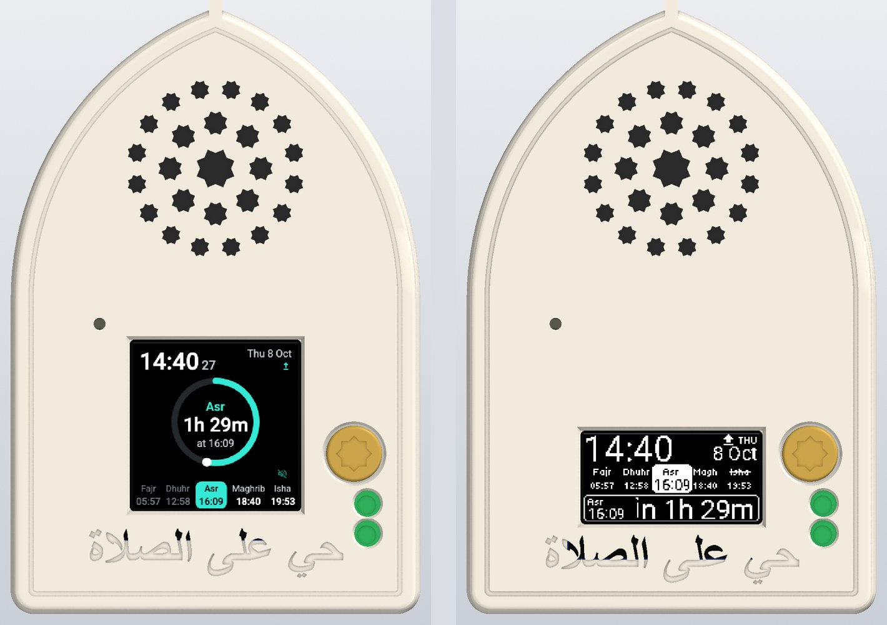
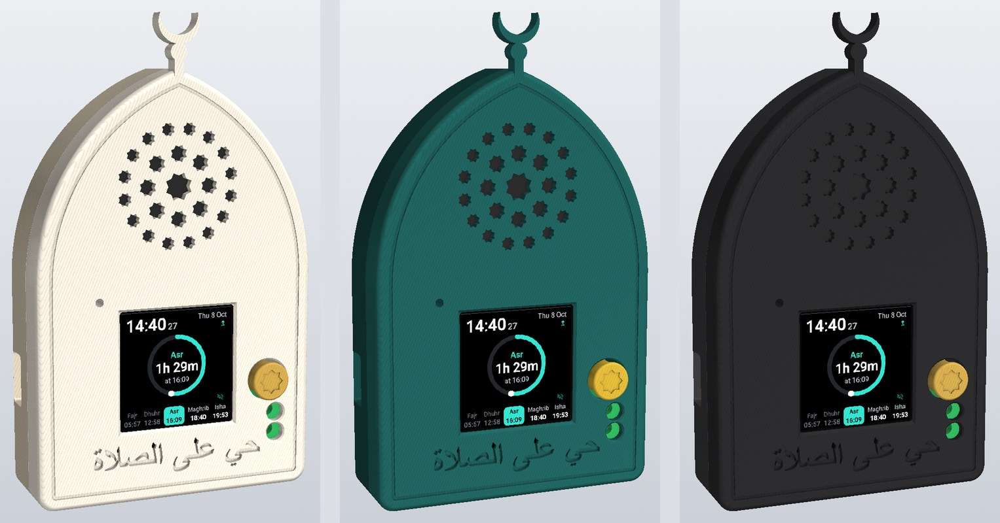
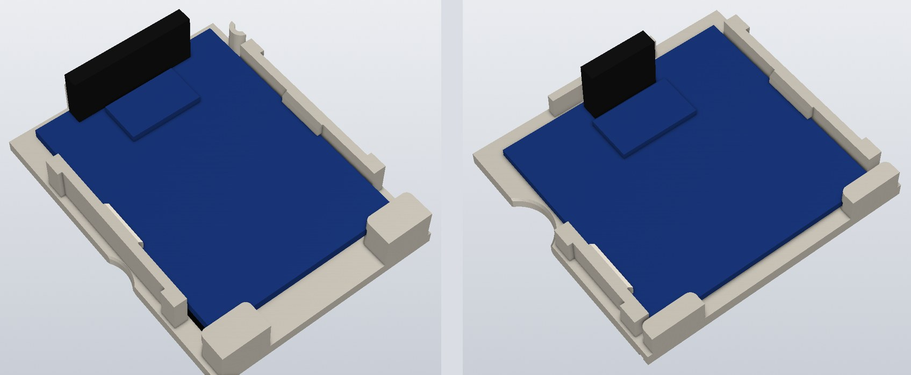
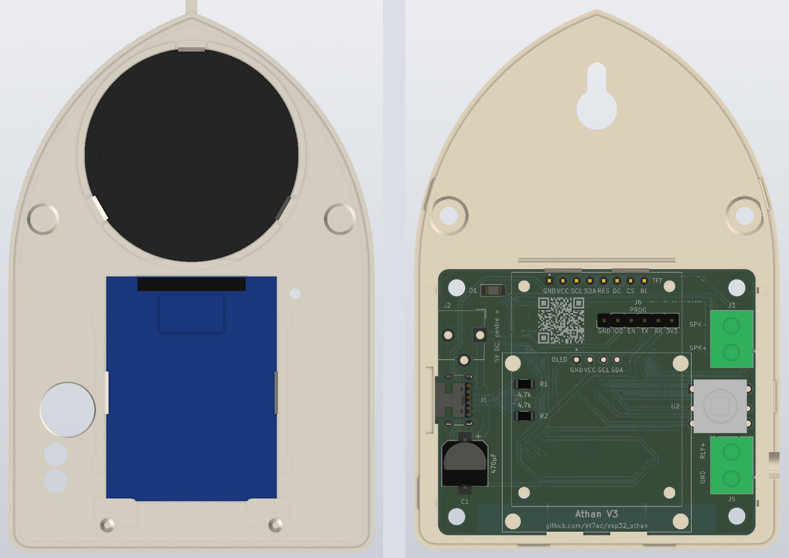
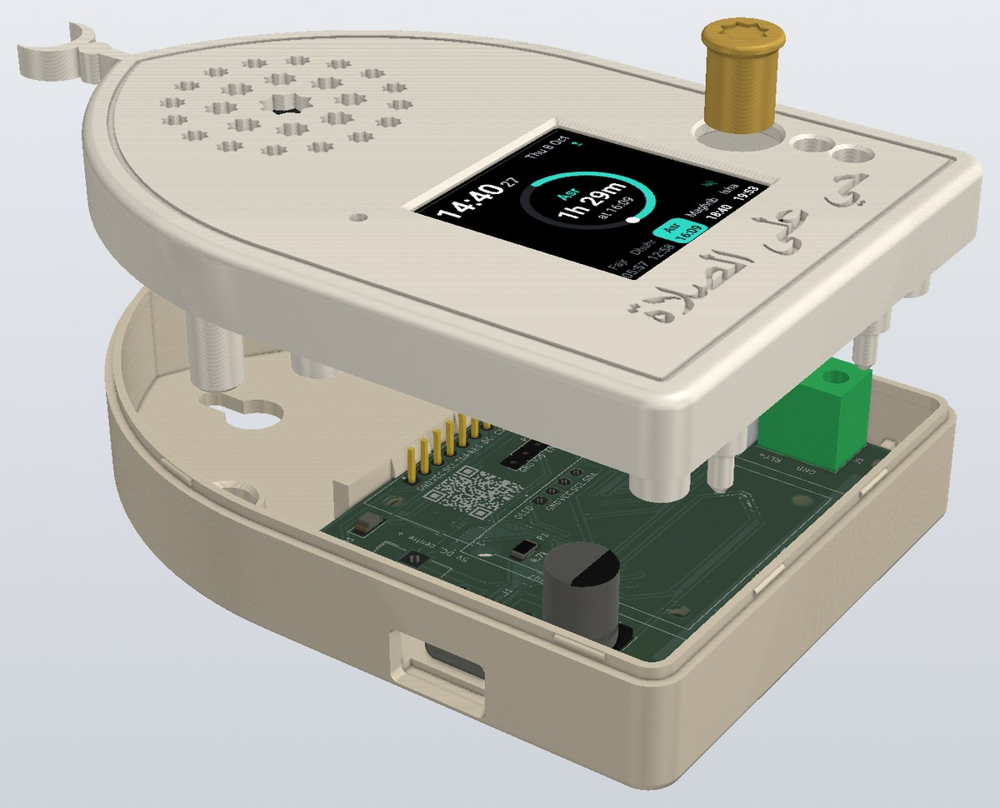
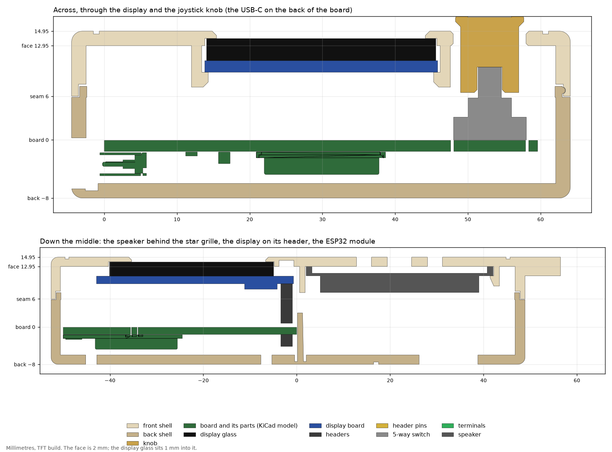
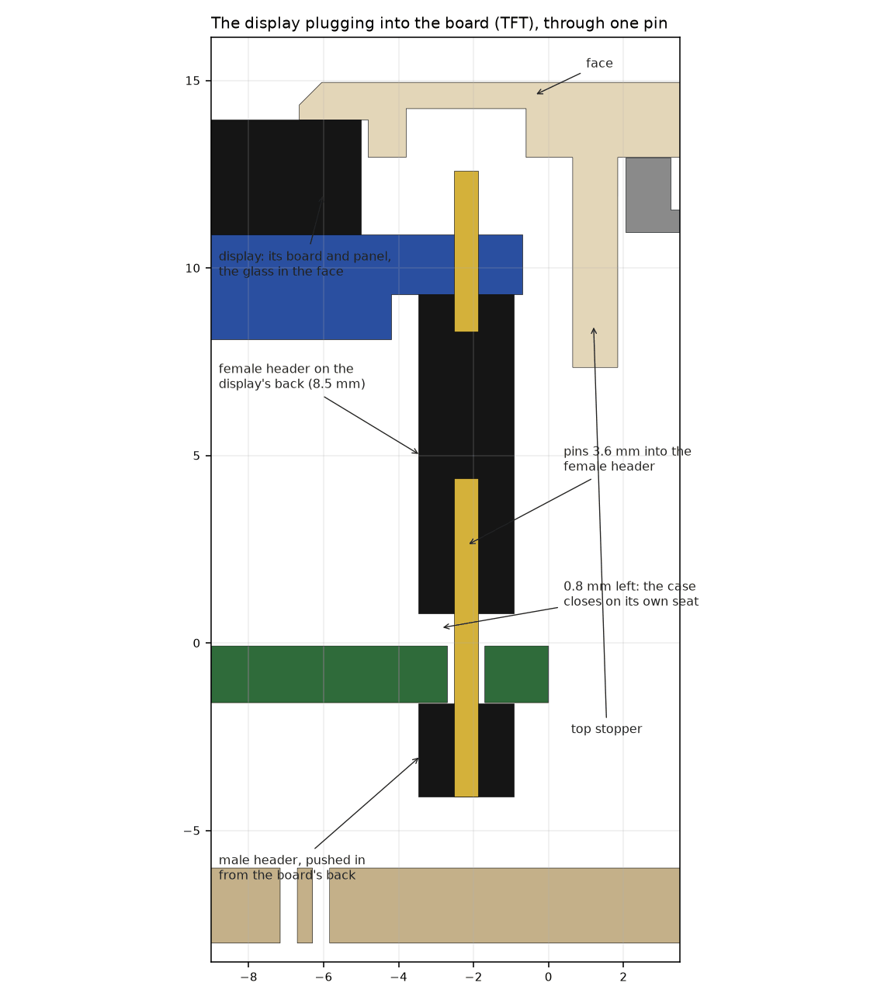
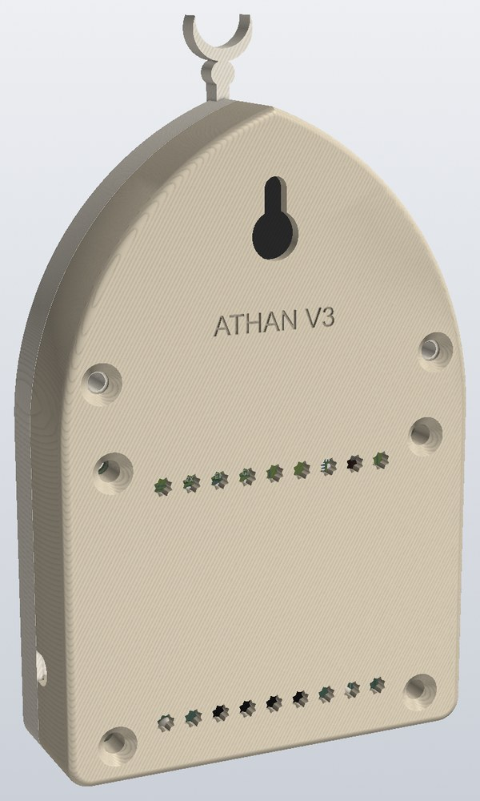

# The case


A 3D-printed case shaped like a mihrab: a rectangle that holds the board, with a pointed arch on top. The display
sits behind a bevelled window, with the joystick knob to its right and the status LED above it. The speaker plays through a grille of eight-pointed stars in the arch, and "حي على الصلاة" is engraved
under the display. The case measures 69 × 114 × 23 mm with the colour screen (21 mm with the OLED), crescent
included. It stands on a shelf or hangs on a wall from the keyhole in its back.

The board clicks into the back, the display clicks into the front, and the front clicks onto the back. As the case
closes, the display plugs into a header on the board. Six screws add hold.



## 1. Print

| Part | File | Pick |
|---|---|---|
| Front | `stl/front_tft.stl` or `stl/front_oled.stl` | the display you fit |
| Back | `stl/back_usbc_on_back.stl` or `stl/back_usbc_on_front.stl` | the side of the board the USB-C J1 is soldered on (JLCPCB puts it on the back) |
| Knob | `stl/knob_tft.stl` or `stl/knob_oled.stl` | the one for your front (the OLED's face is 1 mm lower) |
| Window test | `stl/window_test_tft.stl` or `stl/window_test_oled.stl` | optional: a few minutes, to check your display's window and click before printing the front |

- PLA or PETG, 0.15 to 0.2 mm layers, 3 walls, 15 to 20 % infill, no supports. The files are already turned the
  way they print: the front lies on its face, the back on its back, and the knob stands on its shaft.
- PETG suits the back best: the spring that holds the board bends partly across the print's layers, where PLA is
  weakest.
- The engraved text is on the face, the side that lies on the bed. To keep its letters open, set Cura's Initial Layer
  Horizontal Expansion to −0.1 or −0.2 mm: it stops the first layer spreading into them.
- Two or three colours look good: the front and the back in different colours, the knob in a third.



## 2. Also needed

- **Display headers,** 4 pins for the OLED or 8 for the colour screen, both the common 2.54 mm kind:
  - a male header (2.5 mm plastic, 6 mm long pins) for the board;
  - a female header, 8.5 mm tall, for the display.
- **Screws (optional):** 6 × M3 × 16 mm, countersunk, no longer. They cut their own thread in the plastic. Pan-head
  screws work too, but their heads stand out at the back.
- **Speaker:** 40 mm round, 4 Ω 3 W, up to 18.5 mm deep with the colour screen's front (16.5 mm with the OLED's).
  Three clips hold its rim, which suits a rim about 2 mm thick. A speaker of the same diameter with a different rim
  holds with three dots of hot glue.
- **Light pipe (optional):** 1.75 mm clear filament carries the status LED's light to the face: 13.8 mm of it with the
  colour screen's front, 11.8 mm with the OLED's.
- **The board as the case expects it:**
  - No barrel jack J2: the case has no opening for it.
  - With the colour screen, no header in J6, which sits under the display. Flash through J6 with the press-in
    programmer ([hardware/programmer](../programmer/README.md)).
  - C1 at most 10.5 mm tall.

## 3. Before you start

**Test the window.** Print the window test and click your display into it (section 4, step 4): the glass drops into
its pocket, the screen sits centred in the window, the board's bottom edge rests in the two grooves and the two
springs snap over its sides.

- The colour screen's numbers come from a 1.54" ST7789 module tried in this test: 42.2 mm long, 4.65 mm from the
  glass front to the back of its board.
- The OLED's follow LCDWiki's drawing of the MC130GX.

If yours differs, change its numbers in `DISPLAYS` at the top of `enclosure.py` and build the parts again
(section 6).



## 4. Putting it together

1. **The board's header.** Push the male header into the board from the back, at DS2 for the colour screen or DS1
   for the OLED: plastic against the back, long pins up through the board. Solder it on the front, then cut the
   short ends flush with the plastic. The pins stand 4.4 mm above the board.
2. **The display's header.** Solder the female header onto the display's back, its tails through to the front.
   - Colour screen: leave the tails as they are.
   - OLED: cut the tails to about 1.3 mm, so that tail and solder together stay under 1.6 mm and fit the groove
     inside the face.
3. **The front.** Lay the front on its face. Press the speaker into the clips inside the arch, cone toward the
   grille. Push the light pipe into the tube by the LED hole.
4. **The display into the front.** Slide the bottom edge of the display's board into the grooves of the two stops at
   the bottom of the window, glass toward the face. Then press its top end down into the pocket, past the stopper at
   its top edge, until the springs at both sides click over the board. Flexing the springs out a little helps.
5. **The board into the back.** Slide the board's bottom edge under the two ledges by the bottom wall, then press its
   top edge down until the spring along it clicks over it. Ribs at the sides keep it centred.
6. **Wires.** Connect the speaker to J3 (SPK+, SPK−); the face covers J3, so this is done with the front off. Lead the
   relay wires in through the hole in the right side and into J5.
7. **The knob.** Press the knob onto the switch's stem, star point up. It then tilts four ways and presses in.
   - It stays on: its cap is narrower than the hole in the face, so the front goes on and comes off over it.
   - A knob that is too tight goes on after the square hole is opened a little with a file; a loose one takes a drop
     of glue. To print the hole wider or narrower, change `KNOB_FIT` at the top of `enclosure.py`.
8. **Close it.** Put the front straight onto the back:
   - the two long posts in the arch enter their sockets first, 8.8 mm before the case closes;
   - then two pins go through the board's spare display holes and line the board up with the front;
   - only then, in the last 3.6 mm, does the display's header slide onto the board's;
   - the knob comes up through its hole.

   Press until the rim clicks all round.
9. **Screws (optional).** Drive the six screws in from the back. The four at the corners clamp the board between the
   front's posts and the back's tubes; the two in the arch go into the long posts.

**Opening it.** Take out the screws, if fitted, and pull the front straight off: the display comes away with it.

- **The display:** to take it out of the front, push the two springs outward, lift its top end, and draw its
  bottom edge out of the grooves.
- **The board:** to take it out of the back, push the spring at its top edge back at the middle, and lift that edge.





## 5. How it fits



- **The display on the board:** the display's board sits 9.3 mm above the main board.
  - When the case is closed, the board's pins are 3.6 mm into the female header, with 0.8 mm left between the header
    and the board.
  - The case closes on its own seat (the front's posts on the board, its rim on the back), so the headers never push
    the display back or hold the front open.
  - A groove inside the face takes the female header's soldered tails.

  
- **The display in the front:**
  - Its glass sits 1 mm into the 2 mm face, behind a bevelled frame. The window shows the screen's visible area with
    0.5 mm to spare on each side.
  - Two stops under the board's bottom edge each have a groove, 0.8 mm deep, that the board's edge sits in.
  - The two springs are walls 1.4 mm thick on the face, 0.4 mm from the board's sides, with a post at each end. A lip
    in the middle of each, 8 mm long, catches 0.5 mm under the board, with a slope underneath that lets the board
    push the wall outward on its way in.
  - On the OLED's front the right spring is shorter and sits below the knob, which leaves no room beside it.
  - A stopper stands over the board's top edge: on the colour screen's front it is the lowest stretch of the
    speaker's ring, carried down.
- **The board in the back:**
  - Two ledges hold its bottom edge.
  - A spring runs along its top edge: a wall 1.3 mm thick at the plate and 1.1 mm at the top, 35.6 mm long, held by a
    post at each end, so its middle bends outward. Two lips on it, 7 mm wide, snap 0.5 mm over the board.
  - Four ribs stop 0.2 mm from its sides.
  - It rests on the four screw tubes.
- **The front on the back:**
  - The back's rim rises 1.5 mm inside the front's, and six beads on it click into grooves in the front.
  - The seam is flush outside, with a 0.15 mm gap.
- **Height:** the face is 13 mm in front of the board (10.9 mm with the OLED), set by the display on its headers.
  - Under the face the tallest part is C1.
  - The relay terminal J5's two screws are reached through two 4.4 mm holes in the face, 4.7 mm deep (2.6 mm with
    the OLED). The speaker terminal J3 stays under the face. Both have 3 mm beside them for the wires.
- **Knob:** a 9.4 mm cap with an eight-pointed star engraved on it, on an 8 mm shaft, in a 10 mm hole. The shaft has
  1 mm all round to tilt, and the cap passes through the hole.
- **Text:** engraved 1.2 mm deep into the 2 mm face, 8.3 mm tall.
- **Connectors:** the USB-C opening is 12.6 × 7 mm, room for common cable plugs.
- **Antenna:** nothing metal comes within 17 mm of the ESP32's antenna at the bottom edge. The screws are at the
  corners and in the arch, and so is the speaker.
- **Back:** star-shaped vents sit over the amplifier and the module, and a keyhole takes a screw in the wall.



## 6. Changing it

`enclosure.py` builds every part with [CadQuery](https://cadquery.readthedocs.io) (Python 3.10 to 3.12):

```bash
pip install cadquery arabic-reshaper python-bidi
python enclosure.py                       # writes stl/ and step/
python enclosure.py --check ../pcb/generated_imgs_and_3d/esp32_athan.step
python enclosure.py --assembly ../pcb/generated_imgs_and_3d/esp32_athan.step
```

- **The numbers** at the top of `enclosure.py`:
  - the board's positions (copied from the KiCad file);
  - the displays and their headers;
  - the speaker, the walls, the clicks and the knob.
- **`--check`** checks every part against the board's STEP model from `hardware/pcb/generate_fab_files.sh`.
  - The board is checked as the case expects it: no header in J6, C1 up to 10.5 mm.
  - Parts KiCad has no model for are added: the displays and their headers, the switch, the terminals, the speaker.
  - It prints how far the headers mate and how early the guides catch, then "fits" for each display and USB-C side,
    or what would collide. Run it after changing the board or the case.
- **`--assembly`** writes `step/assembly_tft.step` and `step/assembly_oled.step` (about 18 MB each). Each is the
  closed clock with everything in it: the board and its parts, the display and both headers, the speaker and the
  case.
- **The STEP files:**
  - The single parts in `step/` sit where the board's STEP puts the board, so the two open together.
  - The assembly files are in the case's own frame: the origin is the board's top-left corner on its front surface.
- **The engraved text** needs a font with Arabic letters (Arial on macOS and Windows). `FACE_TEXT = ''` leaves it
  off.
