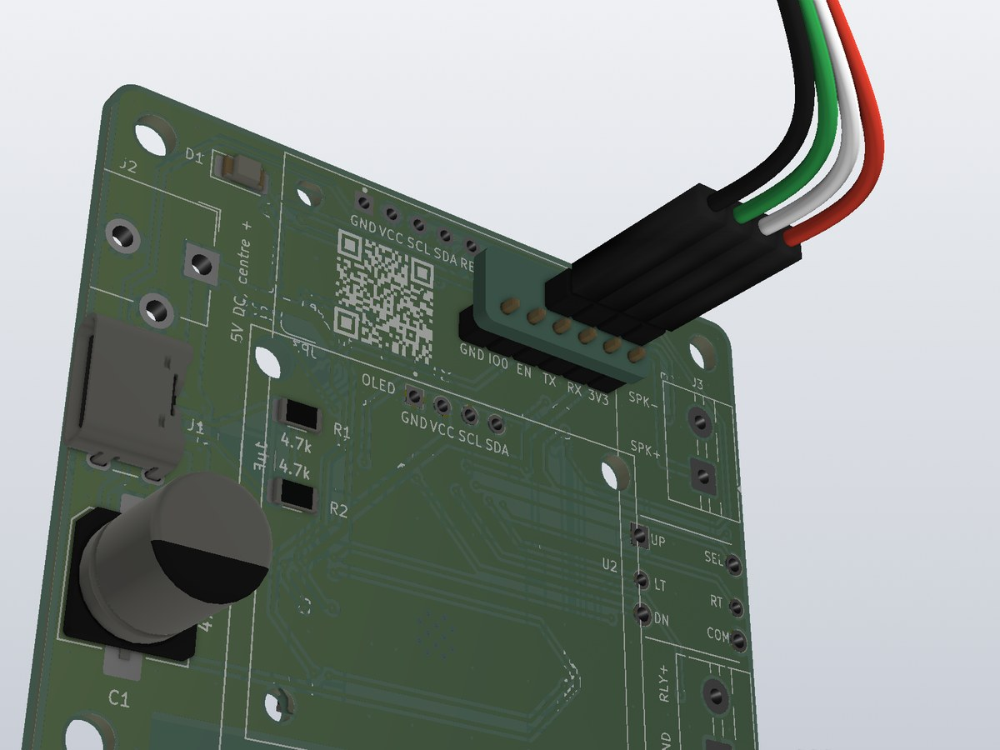
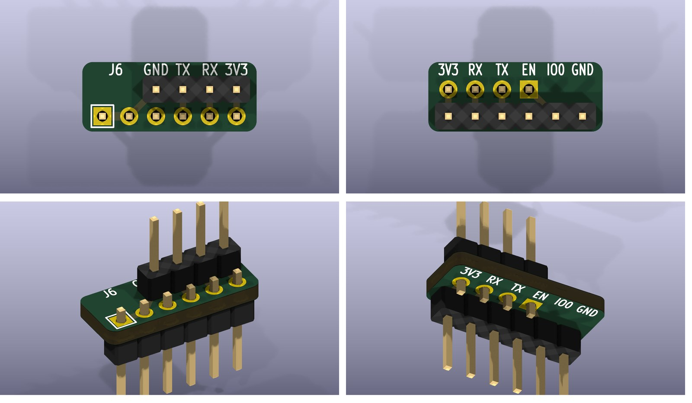

# The programmer

A 16.5 × 6.6 mm board for flashing the clock without soldering a header onto J6. It carries two ordinary 2.54 mm
male headers, one row apart:

- **Underneath:** a 1×6 header whose pins drop into J6's holes unsoldered.
- **On top:** a 1×4 header for the four jumper wires: GND, TX, RX and 3V3.

On the board, GPIO0 (IO0) is joined to GND, so the ESP32 starts in download mode as soon as it is powered through the
programmer.

The top names the four jumper pins. The back names J6's six pins, each above the column of the J1 pin that goes
into it (from the back, GND is at the right).

## 1. Making it

- **The board:** `./generate_fab_files.sh` (KiCad need not be open) writes `fab_files/athan_prog.zip`. Order it as a
  2-layer board, 1.6 mm thick. The KiCad project is `athan_prog.kicad_pro`.
- **The 1×6 header (J1)** goes in from below: plastic under the board, long pins pointing down. Solder it on top.
- **The 1×4 header (J2)** goes in from the top, in the row printed GND TX RX 3V3. Solder it underneath.
- **Trim:** cut both headers' short ends flush. Standard headers are long enough; no long-pin header is needed.

## 2. Flashing with it

1. **Wire a 3.3 V USB-serial adapter** to the four pins on top: GND to GND, 3V3 to 3V3, the adapter's RX to TX, and
   its TX to RX.
2. **Put it on J6.** Unplug the clock's USB-C. Push the lower pins into J6, GND to GND: the pin with the printed
   square on top goes into J6's square pad, which has "GND" printed beside it on the clock. Tilt the programmer a
   little so the pins press against the holes.
3. **Flash.** The clock powers up from the adapter's 3V3 and starts in download mode. Flash it as in
   [guides/building.md](../../guides/building.md) section 4, choosing the adapter's port.
4. **Restart.** Take the programmer out and power the clock from its USB-C: it starts the new firmware.

- **3V3 only, GND to GND.** 5 V on the 3V3 pin damages the ESP32. Turned round, the programmer puts the adapter's
  3V3 on the clock's GND.
- **Power:** the adapter's 3V3 powers the whole clock, and the ESP32 needs about 100 mA while it flashes. An adapter
  that can't supply that (an FT232RL's 3V3 gives 50 mA) works with its 3V3 left off. The clock then runs from its
  USB-C, plugged in after the programmer is in J6, because the ESP32 reads GPIO0 only as it starts.
- **The log:** to read the running firmware's log, start the clock first (USB-C, the adapter's 3V3 left off), then
  put the programmer in. GPIO0 doesn't matter once the clock is running.
- **TFT:** in the case, J6 sits under the TFT, which is held in the case's front. Take the front off to reach J6.

## 3. How it is wired

| J1 pin (into J6) | J6 | Joined to |
|---|---|---|
| 1 | GND | J2 pin 1, GND |
| 2 | IO0 (GPIO0) | GND, on the board |
| 3 | EN | nothing (below) |
| 4 | TX (the ESP32's TXD0) | J2 pin 2, TX |
| 5 | RX (the ESP32's RXD0) | J2 pin 3, RX |
| 6 | 3V3 | J2 pin 4, 3V3 |

J2 sits over J1's pins 3 to 6. The ESP32 reads GPIO0 as it comes out of reset, and low means download mode. Whenever
the programmer is out, the clock's own 4.7 kΩ pull-up (R4) keeps GPIO0 high.

**Why EN is not connected.** EN is the ESP32's reset, and the clock already drives it: R3 (4.7 kΩ to 3V3) and C5
(1 µF to GND) hold the ESP32 in reset for a few milliseconds after power comes on, then let it start. That start
is when GPIO0 is read, and the programmer has already pulled GPIO0 low. Wiring EN to GND would hold the ESP32 in
reset, and wiring it to 3V3 adds nothing to R3, so the pin only steadies the programmer in J6. Adapters that reset
the chip by themselves use their DTR and RTS lines with two transistors; the programmer leaves that out to keep four
wires. To start over in download mode, power the clock off and on again.
